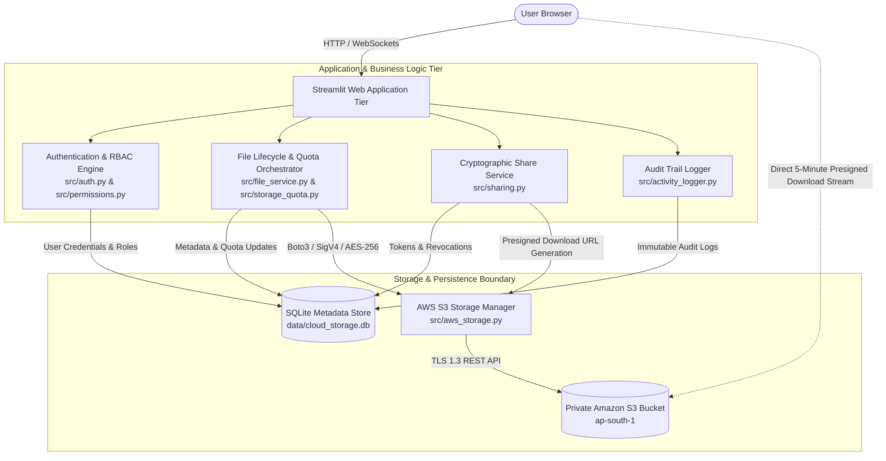
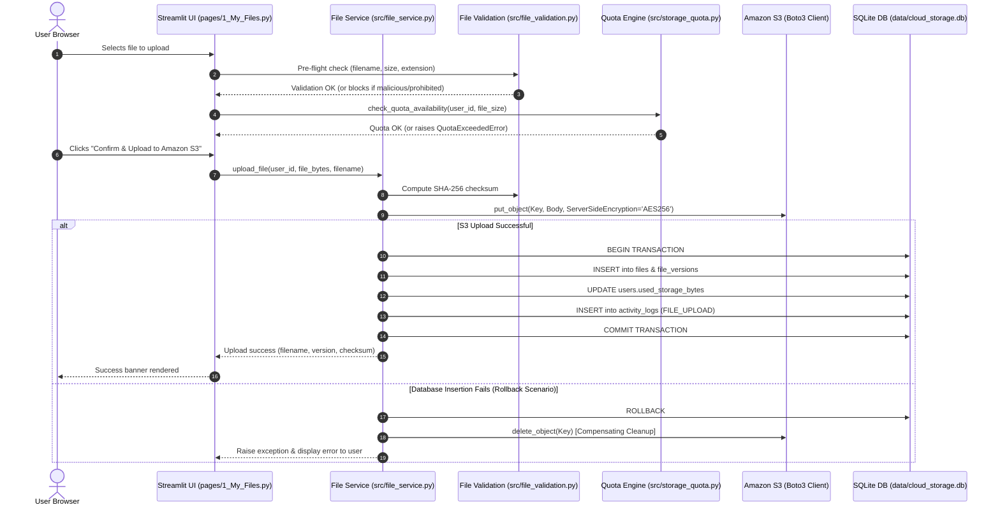
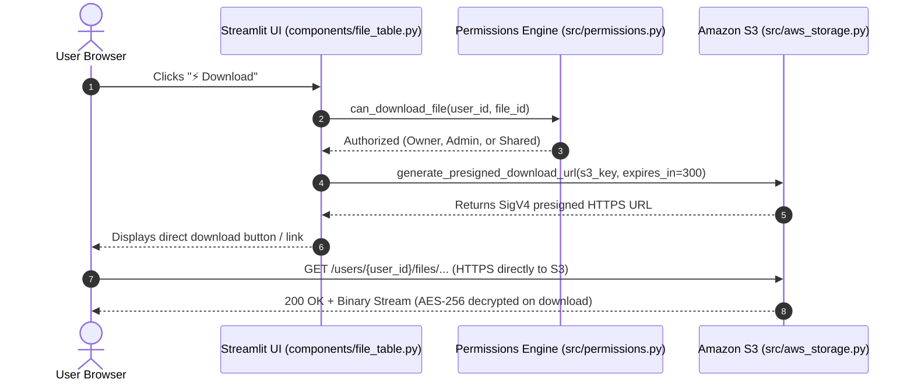

# System Architecture: Cloud File Storage System

**Project:** CODSOFT Cloud Computing Internship — Task 1  
**Architecture:** Decoupled Multi-Tier Cloud Application  
**Runtime:** Python 3.11 | Streamlit UI | Amazon S3 | SQLite 3 / PostgreSQL  

---

## 1. High-Level Architectural Overview

The **Cloud File Storage System** is built upon a decoupled cloud architecture designed to separate high-throughput binary object persistence from relational metadata indexing, access delegation, and user interface rendering.



---

## 2. Request Flow Architecture

The application enforces a strict unidirectional request flow that guarantees authorization, validation, and quota availability before any interaction with the cloud object store or metadata database occurs:

```text
[ 1. Streamlit UI Presentation ]
               │
               ▼
[ 2. Authentication & Authorization ]
   - Session State Validation (st.session_state["current_user"])
   - Role-Based Access Control (src/permissions.py: is_admin, can_view, can_download)
               │
               ▼
[ 3. File & Sharing Domain Services ]
   - Pre-flight Validation (src/file_validation.py: extension blacklist, filename sanitization, size checks)
   - Capacity Allocation (src/storage_quota.py: quota ceiling verification)
   - Cryptographic Token Minting (src/sharing.py: 256-bit URL-safe tokens)
               │
               ▼
[ 4. Metadata & Audit Persistence ]
   - Transactional SQLite Execution (src/database.py: PRAGMA foreign_keys = ON)
   - Metadata Insertion (files, file_versions, file_shares)
   - Immutable Activity Logging (activity_logs table)
               │
               ▼
[ 5. Private Amazon S3 Object Storage ]
   - User-Partitioned Keys: users/{user_id}/files/v{version}/{filename}
   - Server-Side Encryption: AES-256 (SSE-S3)
   - Presigned URL Generation: Short-lived (5-minute) SigV4 authenticated URLs
```

---

## 3. Boundaries: Metadata Store vs. Object Storage

A foundational design principle of this architecture is the clean separation of responsibilities between **Application Metadata** and **Binary Object Storage**.

| Attribute | Application Metadata Store (SQLite 3) | Cloud Object Store (Amazon S3) |
| :--- | :--- | :--- |
| **Location** | Local filesystem (`data/cloud_storage.db`) / RDS PostgreSQL | AWS Region `ap-south-1` (`cloud-file-storage-kaushik-2026`) |
| **Content Stored** | User accounts, password hashes, file names, sizes, MIME types, SHA-256 checksums, share tokens, expiration dates, revocation states, and audit trails. | Raw binary file payloads (encrypted with AES-256). |
| **Access Control** | Enforced via application logic and SQL parameterized queries. | Protected via AWS IAM least-privilege credentials and S3 Block Public Access. |
| **Bandwidth Impact** | Extremely low (small metadata queries, indexed lookups). | High throughput; offloaded directly to AWS edge/S3 infrastructure via presigned URLs. |
| **Direct Access** | Never accessible directly by the client browser. | Accessible only via time-limited, cryptographically signed SigV4 presigned URLs. |
| **Integrity** | ACID-compliant relational transactions with foreign key cascades. | S3 object versioning and SHA-256 checksum verification. |

---

## 4. Operational Workflows & Sequence Diagrams

### 4.1 End-to-End File Upload Workflow
When a tenant uploads a file, the application guarantees data integrity and prevents orphaned cloud objects via transactional rollback.



### 4.2 File Download Workflow (Presigned URL Delegation)
The application never proxies large binary streams through the web server, avoiding memory spikes and bandwidth bottlenecks.



### 4.3 Secure File Sharing Lifecycle
Share links operate via cryptographically random tokens (`secrets.token_urlsafe(32)`):

1. **Generation:**
   - Owner selects permission level (`view` vs. `download`), expiration duration (1h, 24h, 72h, 168h), and optional recipient email.
   - Server mints a 256-bit entropy token and records it in `file_shares`.
2. **Access Evaluation:**
   - When loaded via `?share=<token>`, the server queries `file_shares`.
   - Validates that `is_revoked == 0` and `CURRENT_TIMESTAMP < expires_at`.
   - If `shared_with_email` is set, verifies that `current_user.email` matches the restricted email.
3. **Permission Enforcement:**
   - **View-Only:** Renders file metadata, owner, size, and SHA-256 checksum with an explicit banner `"👁️ View-Only Access Enforced"`. The S3 presigned URL generator is never called, and download buttons are completely stripped from the UI.
   - **Download:** Generates a 5-minute presigned download URL and renders `"📥 Ready for Secure Download"`.
4. **Instant Revocation:**
   - The file owner or an administrator can revoke the link at any time from the `"Shared by Me"` dashboard.
   - The database sets `is_revoked = 1`. Any subsequent access immediately fails with `"🚫 Access Denied: This share link has been revoked by the owner."`

---

## 5. Security & Isolation Controls

### 5.1 Multi-Tenant Prefix Isolation
Objects in Amazon S3 are partitioned strictly by tenant ID:
```
s3://cloud-file-storage-kaushik-2026/users/{user_id}/files/v{version_number}/{sanitized_filename}
```
All S3 operations require the caller's session `user_id`. Queries strictly filter `WHERE user_id = ?`, making cross-tenant metadata inspection or object retrieval impossible.

### 5.2 Server-Side Encryption (SSE-S3)
Every object uploaded through `S3StorageManager` explicitly includes:
```python
extra_args = {
    "ContentType": content_type,
    "ServerSideEncryption": "AES256",
}
```
This guarantees that data at rest in Amazon S3 is encrypted using 256-bit Advanced Encryption Standard keys managed by AWS.

### 5.3 Input Defense & Path Traversal Neutralization
`src/file_validation.py` enforces:
- Stripping directory separators (`/`, `\`) and traversal tokens (`..`).
- Blocking Windows reserved device names (`CON`, `PRN`, `AUX`, `NUL`, `COM1-9`, `LPT1-9`).
- Enforcing safe character whitelist (`[a-zA-Z0-9_.-]`).
- Prohibiting dangerous executable extensions (`.exe`, `.bat`, `.cmd`, `.sh`, `.ps1`, `.msi`, `.vbs`, etc.).

---

## 6. PostgreSQL Production Migration Path

The database schema in `src/database.py` is written in standard SQL-92 to ensure seamless transition from local SQLite to managed PostgreSQL (e.g., Amazon RDS PostgreSQL):

1. **Connection Layer:** Update `get_connection()` to utilize `psycopg2` or `psycopg3` connection pools when `DATABASE_URL` starts with `postgres://` or `postgresql://`.
2. **Auto-Increment Mapping:** SQLite's `INTEGER PRIMARY KEY AUTOINCREMENT` maps directly to PostgreSQL's `SERIAL` / `BIGSERIAL`.
3. **Foreign Keys:** SQLite explicitly requires `PRAGMA foreign_keys = ON;`, whereas PostgreSQL enforces foreign keys by default.
4. **Data Isolation:** All table definitions use standard constraints (`UNIQUE`, `NOT NULL`, `CHECK`), ensuring drop-in compatibility.
